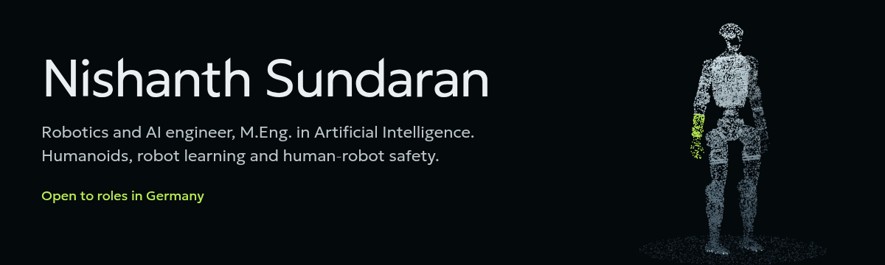

<p align="center">
  <a href="https://nishanthsundaran.github.io"></a>
</p>

<p align="center">
  <a href="mailto:sundharnishanth@gmail.com">
    
  </a>
  <a href="https://www.linkedin.com/in/nishanthsundaran">
    
  </a>
  <a href="https://nishanthsundaran.github.io">
    
  </a>
</p>

---

### About me

I completed my **M.Eng. in Artificial Intelligence** at TH Deggendorf (June 2026). My thesis put a complete human-robot interaction stack on a **real UR3e cobot** in ROS 2 and MoveIt 2: 500 Hz admittance control, an ISO/TS 15066 safety layer and YOLOv8 human perception.

Since then I work on putting learned intelligence on top of robots while keeping safety in its own layer: a local vision-language model that drives two different humanoids, a G1 policy trained from human motion capture, and benchmarks of vision-language-action models. I care most about whether the numbers are true, and my READMEs report what does not work as carefully as what does.

Based in Bavaria, available immediately for robotics and AI roles in Germany, full-time or as a full-time internship leading to a permanent position.

---

### Featured projects

| Project | Stack | What it shows |
|---|---|---|
| [one-brain-many-bodies](https://github.com/NishanthSundaran/one-brain-many-bodies) | MuJoCo, Qwen2.5-VL, PPO, differential IK | A local VLM plans through typed tool calls at ~1 Hz while a compliant whole-body controller runs at ~500 Hz; the same brain drives the Unitree G1 and H1. Measured human-likeness, IK vs learned reaching, and documented negative results. |
| [g1-motion-imitation](https://github.com/NishanthSundaran/g1-motion-imitation) | JAX / MJX, PPO, LocoMuJoCo, LAFAN1 | DeepMimic-style imitation of human motion capture on the G1 at ~30,000 steps/s on a 6 GB laptop GPU; gait within 2 to 7% of the human on four metrics, with the limitations stated. |
| VLA benchmark on LIBERO *(in progress)* | LeRobot, SmolVLA, ACT, Diffusion Policy | Reproducing SmolVLA: traced a gap to the published result to a MuJoCo rendering change and to open-loop action chunks; replanning reached 97% on held-out scenes without retraining. |
| [Human-Robot Interaction with Force Feedback](https://github.com/NishanthSundaran/Human-Robot-Interaction-with-Force-Feedback-in-Collaborative-Tasks) | ROS 2, MoveIt 2, YOLOv8, RealSense D435i, UR3e | Master's thesis: hybrid admittance control, concurrent ISO/TS 15066 safety and human-aware perception, validated on real hardware (4 of 5 assistive-lift trials, peak contact under 21 N). |
| [nishanth_cartesian_admittance_controller](https://github.com/NishanthSundaran/nishanth_cartesian_admittance_controller) | C++, ros2_control | Cartesian admittance controller plugin at 500 Hz with no memory allocation in the update loop and a damped least-squares Jacobian. |
| [embodied_agent](https://github.com/NishanthSundaran/embodied_agent) | Claude tool use, ROS 2, MoveIt 2, Gazebo | Natural-language pick-and-place: a VLM grounds objects in RGB-D, an 8-tool loop plans, a safety gate checks every action. |
| [SLAM_nav_bot](https://github.com/NishanthSundaran/SLAM_nav_bot) | ROS 2 Humble, slam_toolbox, Nav2 | LiDAR mobile robot with online SLAM and a full Nav2 stack; 3 of 3 goals, 0 collisions in a cluttered warehouse simulation. |

---

### What I work with

```
Robot learning  Imitation learning, PPO, reward and evaluation design, LeRobot (ACT, Diffusion Policy, SmolVLA)
Simulation      MuJoCo, MJX, LocoMuJoCo, LIBERO, Gazebo
Robotics        ROS 2 (Humble), MoveIt 2, MoveIt Servo, ros2_control, tf2, URDF/Xacro
Models          Vision-language models as planners (Qwen2.5-VL, Claude), YOLOv8, PyTorch, JAX
Perception      OpenCV, Intel RealSense D435i, hand-eye calibration, point clouds
Control/Safety  Admittance control, force/torque sensing, ISO/TS 15066 (SSM, PFL, hand guiding)
Software        Python, C++, CMake, Git, Linux, pytest
```

---

### Currently

- Benchmarking SmolVLA, ACT and Diffusion Policy on LIBERO.
- Open to robotics software, robot learning and embodied AI roles in Germany.
- Improving German from A2 toward B1.

<p align="center">
  <i>"Build for hardware, document for humans, ship for reality."</i>
</p>
